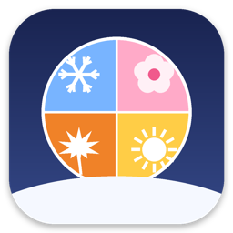
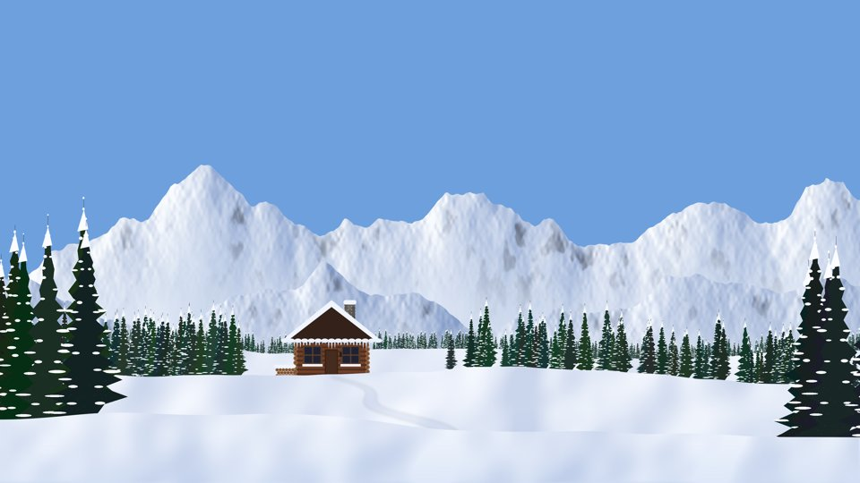
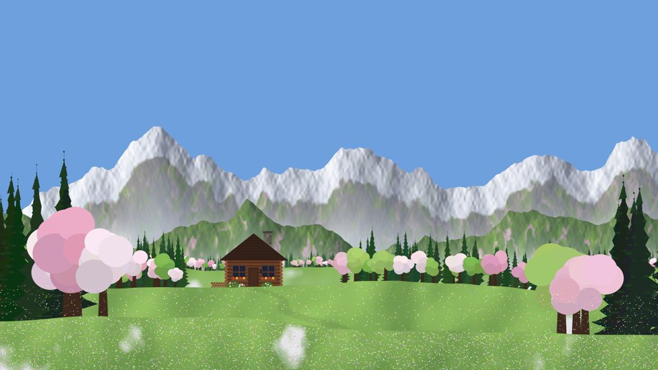
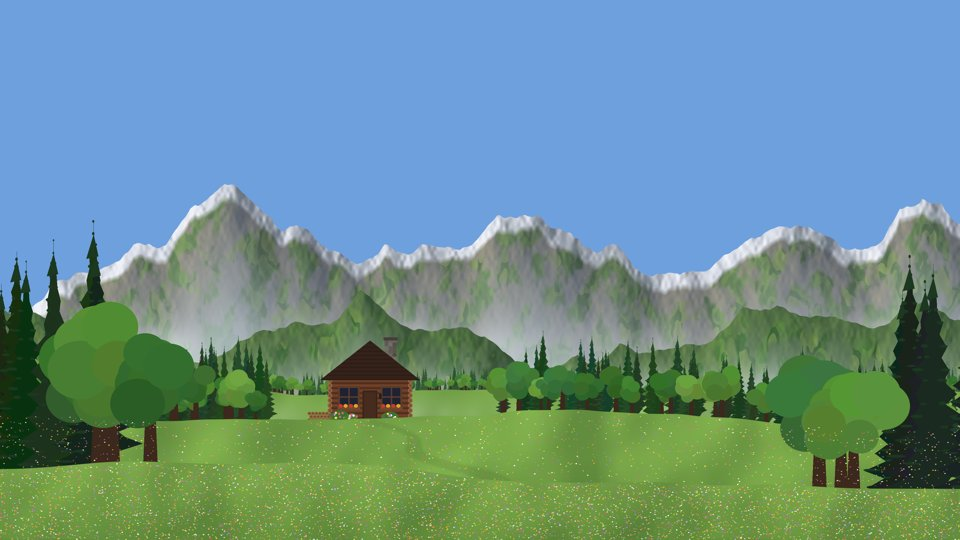
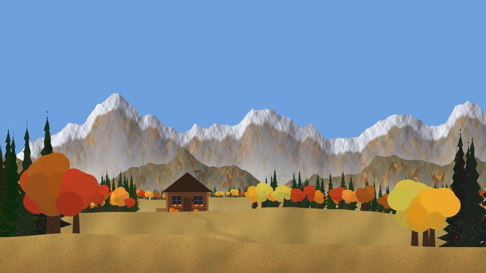

<p align="center"></p>

<h1 align="center">SnowDesk</h1>

<p align="center">
Живые времена года на рабочем столе Mac.<br>
Снег копится на окнах и у Dock, весной тает, летом цветёт, осенью облетает.
</p>

<p align="center">
 <br>
 
</p>

> 🇬🇧 *Living seasons on your Mac desktop: snow piles up on windows and the Dock, melts in spring, blooms in summer and turns golden in autumn — with characters, weather and a live wallpaper that follows the real time of day. Free, open source, CC BY-NC 4.0.*

## Что умеет

**❄️ Зима**
- снегопад, сугроб у Dock и снег на окнах и виджетах — ложится по скруглённым углам и ссыпается с краёв;
- снежки и снеговики мышкой: катай ком по сугробу, бросай, ставь один на другой;
- внедорожник-снегоуборщик с отвалом и мигалкой, дворник с лопатой;
- ёлка с игрушками, физическая гирлянда — вешается между окнами и виджетами, качается от ветра;
- сани Деда Мороза, дети играют в снежки, прохожие, собаки, кошки и хулиган-йети.

**🌸 Весна**
- снег тает (днём быстрее, ночью медленнее), с окон капает, у Dock появляются лужи;
- лепестки цветущей вишни, подснежники, крокусы и тюльпаны;
- птицы садятся на окна и пугаются курсора, по небу пролетает стая клином;
- ребёнок с воздушным змеем, дождь с кругами на лужах.

**☀️ Лето**
- трава и цветы у Dock качаются от ветра, тополиный пух;
- бабочки днём, светлячки ночью, мыльные пузыри;
- яблоня, садовник с газонокосилкой, воздушный шар;
- гроза с дождём и молниями.

**🍂 Осень**
- листопад, кучи листьев на окнах и у Dock — их можно пинать мышкой;
- клён, тыквы у домиков (ночью светятся), дворник с граблями;
- дождь, прохожие с зонтами.

**Живые обои**: пейзаж с домиком в горах для каждого сезона, солнце и луна по реальному времени (Москва), закаты, северное сияние, облака, утренний туман, дым из трубы, свет в окнах ночью.

Сезон выбирается по календарю или вручную. Всё настраивается в окне настроек — щёлкни по значку сезона (❄️ 🌸 ☀️ 🍂) в строке меню.

## Установка

### Готовое приложение

1. Скачай `SnowDesk.zip` из раздела [**Releases**](https://github.com/VovkaProdigy96/SnowDesk/releases/latest) и распакуй.
2. Перетащи `SnowDesk.app` в «Программы».
3. Приложение не подписано платным сертификатом Apple, поэтому при первом запуске macOS его заблокирует. Чтобы открыть:
   - щёлкни по `SnowDesk.app` правой кнопкой → **Открыть** → **Открыть**;
   - или, если такой кнопки нет: **Системные настройки → Конфиденциальность и безопасность → «Всё равно открыть»**;
   - или в Терминале: `xattr -dr com.apple.quarantine /Applications/SnowDesk.app`

### Сборка из исходников

Нужны бесплатные инструменты разработчика Apple (Xcode Command Line Tools). Если их нет, скрипт сам предложит установить.

```bash
git clone https://github.com/VovkaProdigy96/SnowDesk.git
cd SnowDesk
bash build.sh
```

Или двойной клик по `build.command`. Приложение `SnowDesk.app` появится рядом и сразу запустится.

**Требования:** macOS 13 Ventura или новее, Mac на Apple Silicon или Intel.

## Как пользоваться

- **Значок сезона в строке меню** — открывает настройки.
- **Мышкой**: зимой лепи снежки и снеговиков, весной брызгайся в лужах, летом разгоняй пух одуванчиков и пускай пузыри, осенью пинай листья.
- **Гирлянда**: вкладка «Гирлянда» → «Свои точки» → «Редактировать точки» — расставляй точки прямо на экране, цепляй к окнам и виджетам.
- **Своя машина**: вкладка «Машина» → «Своя картинка» (лучше PNG без фона, вид сбоку).
- **«Сутки за 2 минуты»** — быстро посмотреть день, закат и ночь.

Программа лёгкая: падающий снег, листья и обои рисует видеочип, сцена обновляется 30 раз в секунду только там, где что-то меняется.

## Структура проекта

| Файл | Что внутри |
|---|---|
| `main.swift` | окна, сцена, физика снега, снеговики, машина, живые обои, запуск |
| `World.swift` | окна и виджеты, снег на них, гирлянда, ёлка, домики, персонажи |
| `Prefs.swift` | настройки и окно настроек (SwiftUI) |
| `Snowfall.swift` | снег, листья, лепестки, пух и дождь на видеочипе |
| `Autumn.swift`, `Spring.swift`, `Summer.swift` | всё сезонное |
| `scene/` | картинки обоев, облака, туман, иконка |
| `tools/` | скрипты на Python, которыми нарисованы обои, облака и иконка |

## Лицензия

© 2026 **[VovkaProdigy96](https://github.com/VovkaProdigy96)**

Распространяется бесплатно по лицензии [CC BY-NC 4.0](https://creativecommons.org/licenses/by-nc/4.0/deed.ru): можно делиться и переделывать, **указывая автора**, но **нельзя использовать в коммерческих целях**. Подробнее — в файле [LICENSE](LICENSE).
